# Plated in Gold, Part II: From Asking to Selling

<!-- pdf-exclude-start -->
<p align="center">
  <a href="https://andrecdavis.github.io/Plated-In-Gold-Part-II/report.pdf">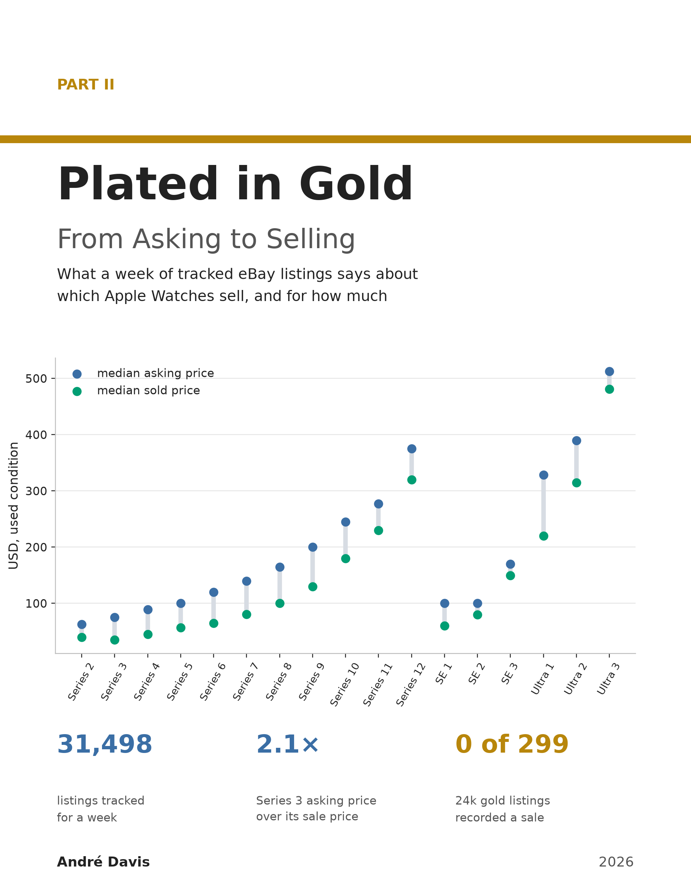</a>
</p>

<p align="center"><b><a href="https://andrecdavis.github.io/Plated-In-Gold-Part-II/report.pdf">Read the full report (PDF)</a></b> · <a href="https://andrecdavis.github.io/Plated-In-Gold-Part-II/">Interactive app</a> · <a href="https://github.com/andrecdavis/Plated-In-Gold">Part I</a></p>
<!-- pdf-exclude-end -->

**▶ Interactive version: [andrecdavis.github.io/Plated-In-Gold-Part-II](https://andrecdavis.github.io/Plated-In-Gold-Part-II/)**. It has filters, an asking-vs-sold explorer, auction bid paths, a sale-probability explainer, a sold-price estimator with SHAP, and a panel on the gold listings.

## Introduction and question

*Part I studied what sellers ask. Part II tracks what actually sells.*

[Part I](https://github.com/andrecdavis/Plated-In-Gold) ([app](https://andrecdavis.github.io/Plated-In-Gold/)) analyzed 2,328 web-scraped Apple Watch listings and found a [gold-plating pitfall](https://github.com/andrecdavis/Plated-In-Gold#the-gold-plating-pitfall): the outdated Series 2 ($743), Series 4 ($676) and Series 3 ($664) averaged higher asking prices than the current Ultra 3 ($651), because many of their listings were aftermarket 24k gold-plated. Its main caveat was that asking prices are not sales.

Part II removes that caveat. A purpose-built collector polled the eBay Browse API for a week (October 19–26, 2026) and followed **31,498** US Apple Watch listings from first sighting until they ended. It recorded **458,087** price snapshots and **3,843** listing outcomes, including **2,063 completed sales**. The question is: *what actually sells, for how much, and how fast?*

> **The main caveats:** one week of data with 51 hours of collection gaps; Best Offer sales are recorded at the list price because the accepted offer is not public; listings whose outcome could not be confirmed are never counted as sales. Details are in [How the data was collected](#how-the-data-was-collected) and [Limitations](#limitations).

## Contents
1. [Headline results](#headline-results)
2. [Asking is not selling](#asking-is-not-selling)
3. [Priced right, sold fast](#priced-right-sold-fast)
4. [The gold-plating pitfall, revisited](#the-gold-plating-pitfall-revisited)
5. [What makes an auction sell](#what-makes-an-auction-sell)
6. [Modeling: will it sell, and for how much?](#modeling-will-it-sell-and-for-how-much)
7. [How the data was collected](#how-the-data-was-collected)
8. [Limitations](#limitations)
9. [Future work](#future-work)
10. [Project structure and reproduction](#project-structure-and-reproduction)

## Headline results

| Listings tracked | Price snapshots | Completed sales | Ended auctions | Sellers |
|:-:|:-:|:-:|:-:|:-:|
| **31,498** | **458,087** | **2,063** | **724** | **20,109** |

1. **Asking prices overstate what old watches sell for.** A used Series 3 is listed at a median of $75 but sells for $35, **2.14×** its sale price (95% CI 1.88–2.34). For a used Ultra 3 the gap is only 1.07× (1.01–1.10). The older the model, the larger the gap.
2. **Part I's ranking flips.** Part I's three most expensive models by asking price (Series 2, 4 and 3) sell for a median of **$35–50** on eBay, against about $500 for the Ultra 3.
3. **Price relative to the market decides how fast a listing sells.** New fixed-price listings priced below 90% of the going rate were **41%** sold within 72 hours; those priced above 150% were **7%** sold (log-rank p = 8.7e-49).
4. **The gold listings didn't sell.** None of the **299** 24k gold listings ended or sold during the week. They ask a median of **$1,199**, **13.5×** what the same model sells for, and have been up for a median of **4.1 years**. Three sellers account for 95% of them. A week is short, so this suggests rather than proves that these prices don't clear.
5. **Auctions are decided late, and newer models and established sellers sell more of them.** 51.5% of ended auctions sold. Series 9 and 10 auctions sold 63% of the time against 36% for the Series 3 (p = 0.0004). The median current bid 24–48 hours before the end is 76% of the final price.
6. **Model and condition set the price.** A CatBoost sold-price model reaches R² = 0.90 (median error 14.7%) under seller-grouped cross-validation. Auctions sell for about $14 less than the average watch with the same attributes, and free shipping makes little difference.

<p align="center">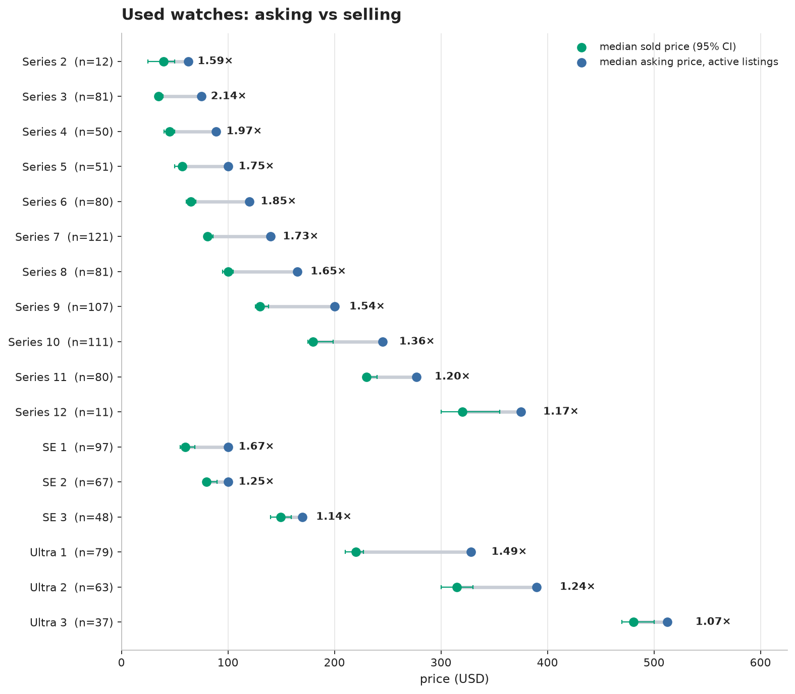</p>

## Asking is not selling

For each model with at least 10 asking prices and 10 sales, we compare the median asking price of listings still active at the end of the week with the median price of completed sales, within the same condition. Intervals are from 4,000 bootstrap resamples.

For **used** watches the ratio falls almost steadily with the model's age:

| Model | Median ask | Median sale | Ask ÷ sale [95% CI] | Sales |
|:--|--:|--:|:-:|--:|
| Series 3 | $75 | $35 | 2.14 [1.88–2.34] | 81 |
| Series 4 | $89 | $45.25 | 1.97 [1.70–2.25] | 50 |
| Series 6 | $119.95 | $65 | 1.85 [1.70–1.92] | 80 |
| Series 9 | $200 | $130 | 1.54 [1.44–1.59] | 107 |
| Series 10 | $245 | $180 | 1.36 [1.23–1.41] | 111 |
| Series 11 | $277 | $230 | 1.20 [1.13–1.23] | 80 |
| Ultra 1 | $328.25 | $220 | 1.49 [1.42–1.59] | 79 |
| Ultra 2 | $389.99 | $315 | 1.24 [1.17–1.31] | 63 |
| Ultra 3 | $512.50 | $480.99 | 1.07 [1.01–1.10] | 37 |

Every interval is above 1, so in every model the typical listing that is still waiting asks more than the typical sale. The ratio does not measure the discount a seller accepts on a given watch: active listings are partly the ones that have *not* sold, often because they're overpriced, so the gap mixes discounting and selection. Both effects matter to a seller reading the asking prices on the site. The same pattern holds for **new** watches (Series 9 1.51×, Ultra 3 1.16×).

### Back to Part I

Part I's asking prices came from a different source and time, so the comparison is between model-level medians rather than the same listings. Still, the result is clear. The Series 2, 4 and 3 averaged $664–743 in Part I, with 42–88% of their listings gold-plated. On eBay they sell for a median of **$49.99, $49.99 and $35**. The Ultra 3, Part I's 4th-ranked model at $651, sells for $499.99, the highest median sale of any model in the comparison.

<p align="center">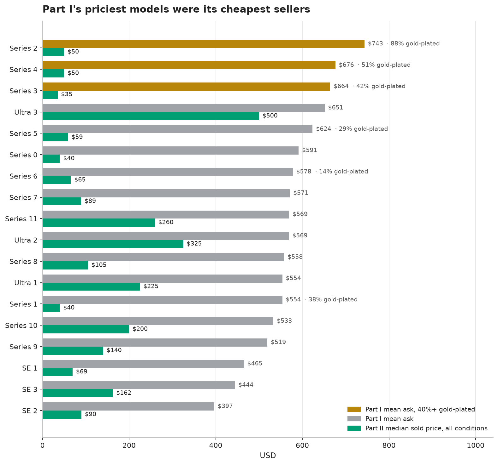</p>

## Priced right, sold fast

For fixed-price listings that started during the week, we compare the first observed price with the median completed sale for the same model and condition, and follow each listing until it sold or the week ended. Listings that ended without a confirmed outcome (247) are treated as censored at their end, not as sales. Kaplan–Meier curves with 95% bands:

<p align="center">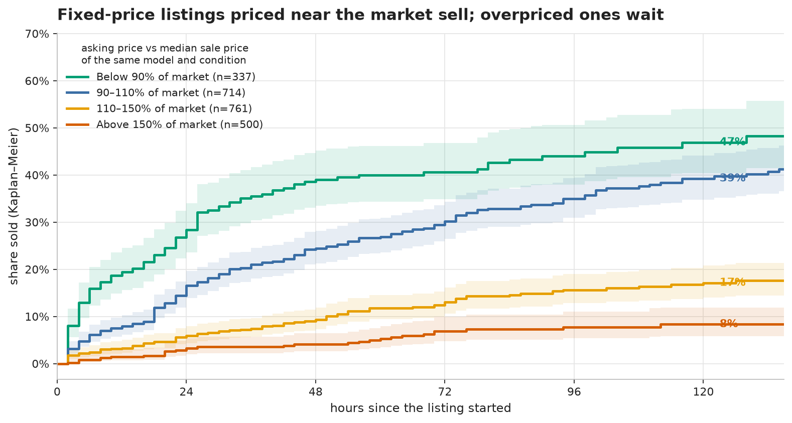</p>

| Price vs market | Listings | Sold by 24 h | Sold by 72 h [95% CI] | Sold by 120 h |
|:--|--:|:-:|:-:|:-:|
| Below 90% | 337 | 28% | 41% [35–47] | 47% |
| 90–110% | 714 | 17% | 30% [26–34] | 39% |
| 110–150% | 761 | 6% | 13% [11–16] | 17% |
| Above 150% | 500 | 3% | 7% [5–10] | 8% |

Across all 2,312 listings, 21% were sold by 72 hours, and the four groups differ sharply (log-rank p = 8.7e-49). Most sellers react slowly: among 26,571 fixed-price watch listings observed more than once, only **9.8%** changed price during the week, and 7.6% ended lower than they started (median cut −5.7%).

## The gold-plating pitfall, revisited

The collector found **299** listings with 24k gold: 292 gold-plated watches, 5 anodized watches with 24k parts, 1 band and 1 plating service. **None of them ended or sold during the week.**

<p align="center">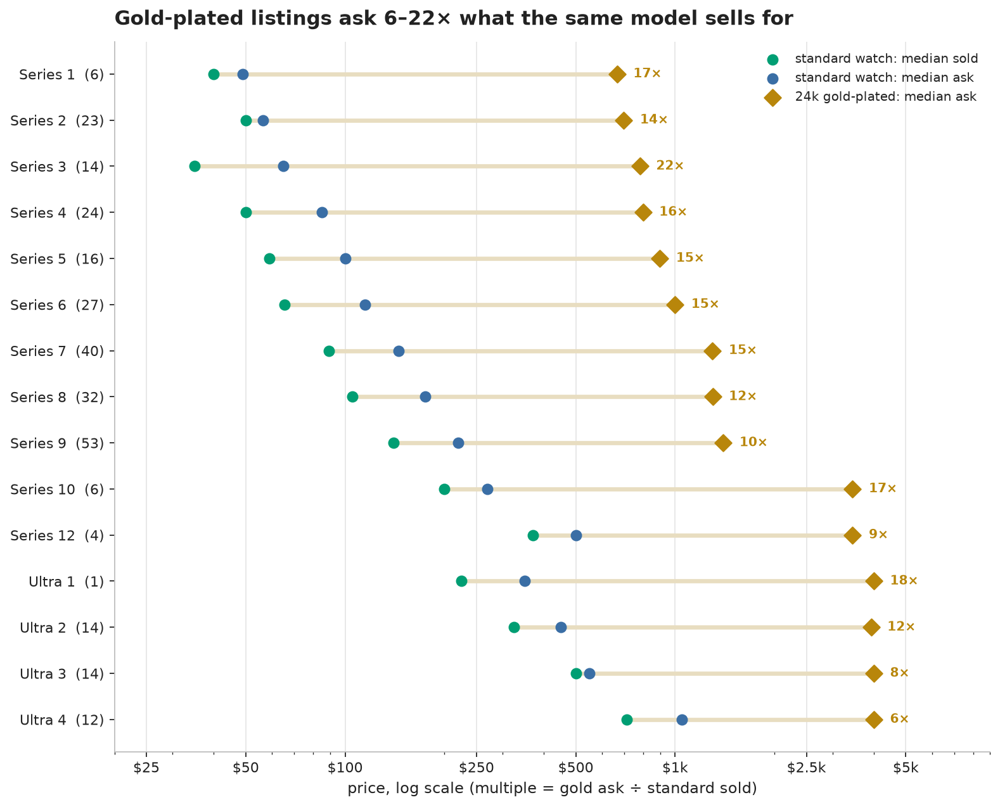</p>

Their median ask is **$1,199** (IQR $881–1,699; range $199–4,749). For the 286 plated watches with an identified model, the median ask is **8.2×** the median ask for the same model and **13.5×** its median sale price, from 6× for an Ultra 4 to 22× for a Series 3.

<p align="center">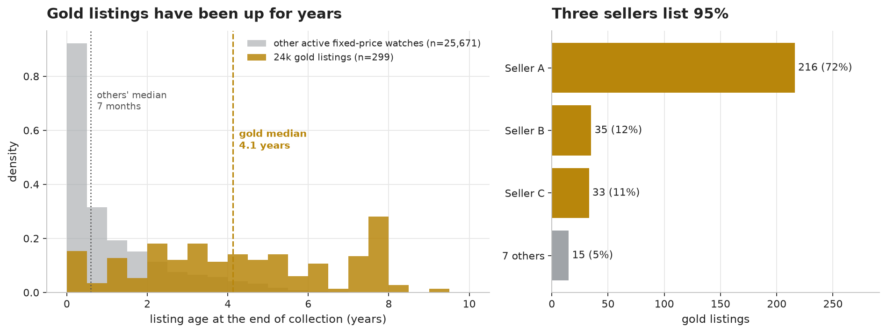</p>

The listings are old and concentrated:
- all 299 are fixed-price, good-'til-cancelled listings (290 with Best Offer)
- the median listing has been up for **4.1 years** (IQR 2.5–6.1), and 82% for more than two years; other active fixed-price watches have been up for a median of 7 months
- **10 sellers** list them, the largest 216 (72%), and the top three 95%
- most are New (163) or Open box (129)

**Does zero sales in a week mean anything?** Gold listings are old, New or Open box, fixed-price listings, so the comparison group is standard listings like that: same models, same conditions, up for at least a year. Those sold at **1.07%** during the week (n = 1,777). At that rate, the 286 plated watches would be expected to produce 3.1 sales, and the chance of seeing none is **0.046**. But comparable standard listings priced at $500 or more sold **0 of 566**, so a high price alone could explain the result.

eBay's lifetime sales counter tells a similar story. Among the 297 gold listings with full details, 45% have never sold a unit; together they have sold 481 units, a median of **0.15 per listing per year**. A quarter (26%) offer more than one unit, which suggests a stocked product rather than a one-off.

**What this means.** Zero completed sales in a week *suggests* that these prices don't clear: few buyers pay more than ten times a model's market price for plating. It does not prove that the watches never sell; the lifetime counters show occasional sales, and a week is short for listings this slow. This is Part I's gold-plating pitfall from the other side: gold listings pushed the old models' average asking prices up, and they're listings that rarely sell.

## What makes an auction sell

Of **724** ended single-watch auctions, **373 sold (51.5%; 95% CI 47.9–55.1%)**. Intervals below are Wilson intervals.

<p align="center">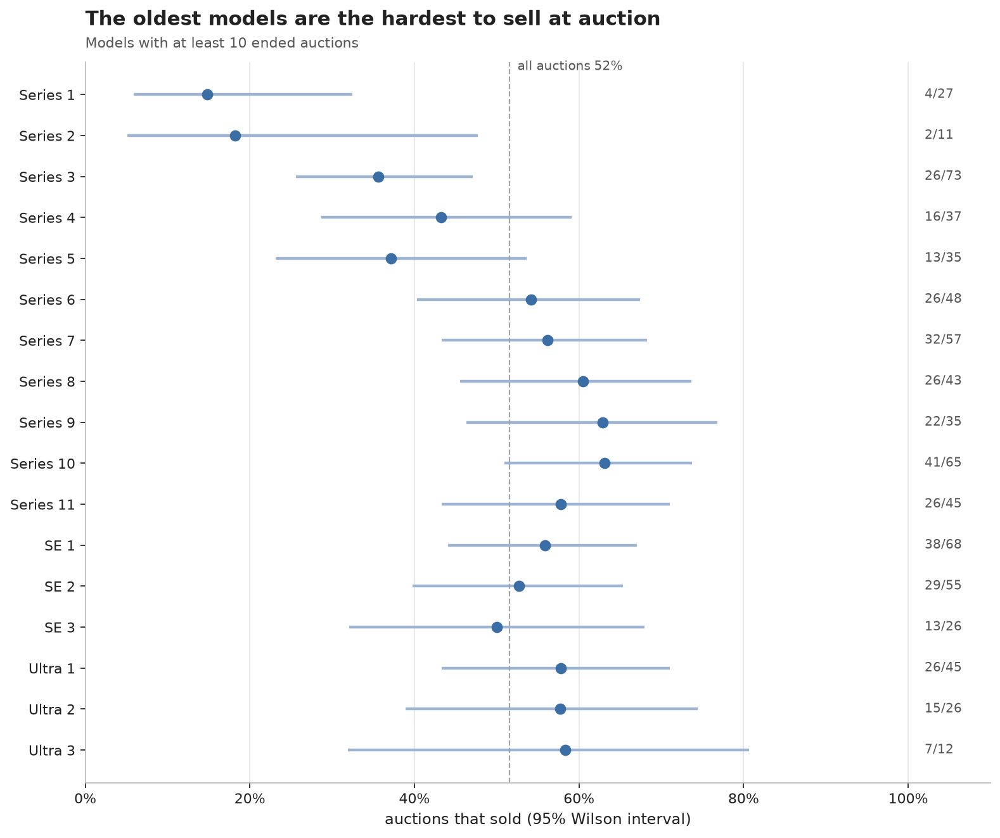</p>

- **Newer models sell more often.** Series 9 and 10 auctions sold 63% of the time (63/100) against 36% for the Series 3 (26/73), a difference of 27 points (95% CI 12–41; p = 0.0004).
- **Seller feedback.** Sellers with 10,000+ feedback sold 69% of their auctions; sellers with zero or negative feedback, 28% (trend p = 0.0002).
- **Shipping.** Free-shipping auctions sold more often (62% vs 50%, p = 0.023), but that difference goes away after adjusting.

<p align="center">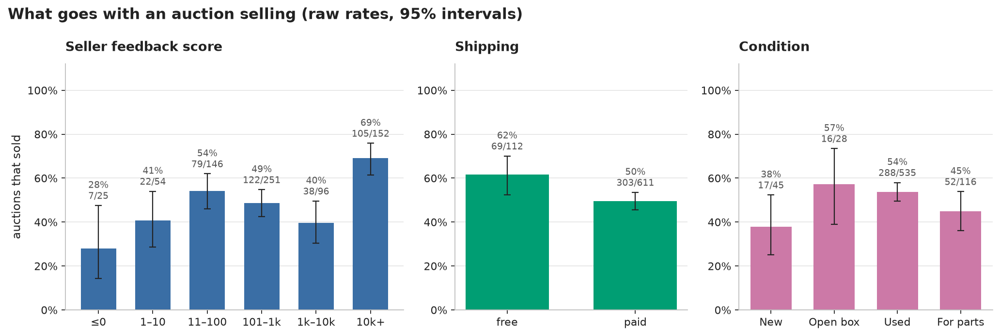</p>

A logistic regression with condition and model family controls (n = 723) gives:
- odds ratio **1.24 [1.10–1.40]** per tenfold increase in seller feedback (p = 0.0006)
- **1.76 [1.24–2.51]** for current-generation models (p = 0.002)
- **1.11 [0.69–1.78]** for free shipping (p = 0.68)

Fixed-price listings show no shipping effect either: 54.8% of free-shipping and 56.3% of paid-shipping listings that ended recorded a sale (p = 0.43).

**Two fields that would mislead.** The database keeps the latest value of each field, and eBay removes Best Offer and Buy It Now from an auction once it gets a bid. Auctions still showing Best Offer at the end sold 4.1% of the time, against 63.5% for the rest, because almost none of them ever got a bid. These flags reveal the outcome, so they're excluded from the auction analysis. The seller's listing count is excluded for a similar reason: unsold auctions are often relisted, which raises the count.

### Auction prices are set late

For the 373 sold auctions, we track the current bid as a share of the final price, using the last observation in each time bin before the end:

<p align="center">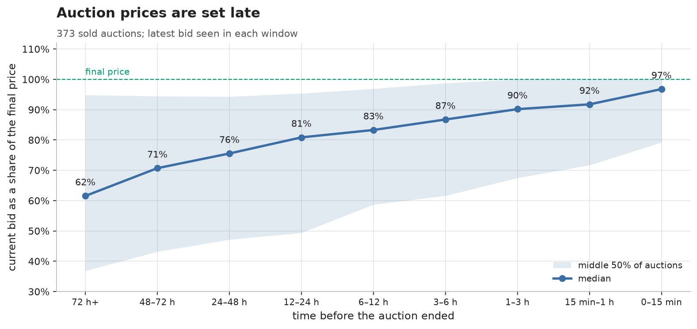</p>

The median auction stood at 62% of its final price more than three days out, **76% at 24–48 hours**, 90% at 1–3 hours and 97% in the last 15 minutes. Even after the last bid seen in the final 15 minutes, 59% of auctions still rose, by a median of **3.3%** (95% CI 1.6–6.2%; n = 197). A sold auction received a median of 10 bids.

## Modeling: will it sell, and for how much?

Both models are CatBoost gradient-boosted trees, validated with five-fold cross-validation **grouped by seller**, so no seller appears in both training and validation. SHAP values come from CatBoost's exact TreeSHAP.

### Will this auction sell?

**Sample:** 525 ended auctions first observed before their first bid, so the opening price is known. 185 of them sold (35%), from 387 sellers. The sold share is lower than among all auctions because the 199 auctions that already had bids when first seen, 94% of which sold, are left out.

**Features:** only what a seller sets at listing time:
- model, condition, case size, cellular
- opening price relative to the market (the median fixed-price sale for the same model and condition)
- auction length, end hour, and whether it ends on a weekend
- shipping cost and free shipping, returns, photo count, reserve
- seller feedback score and percentage, Top Rated Plus

<p align="center">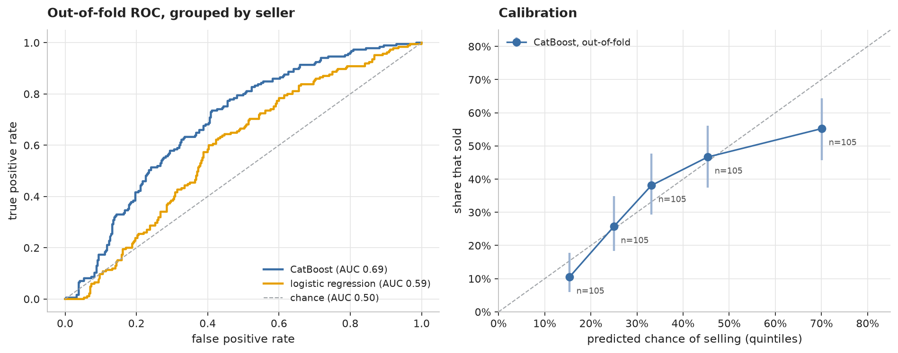</p>

- **Discrimination:** the out-of-fold AUC is **0.69 [0.65–0.73]** (fold range 0.63–0.76), against 0.59 [0.54–0.64] for a logistic regression on the same inputs.
- **Accuracy:** the Brier score is 0.216, against 0.228 for always predicting the base rate.
- **Calibration:** the slope is 0.65, so predictions are too spread out. Its highest-probability fifth predicted 70% and sold 55%. A nested Platt scaling step did not improve the Brier score, so it isn't used.

This is a modest model: useful for ranking, not for exact probabilities.

<p align="center">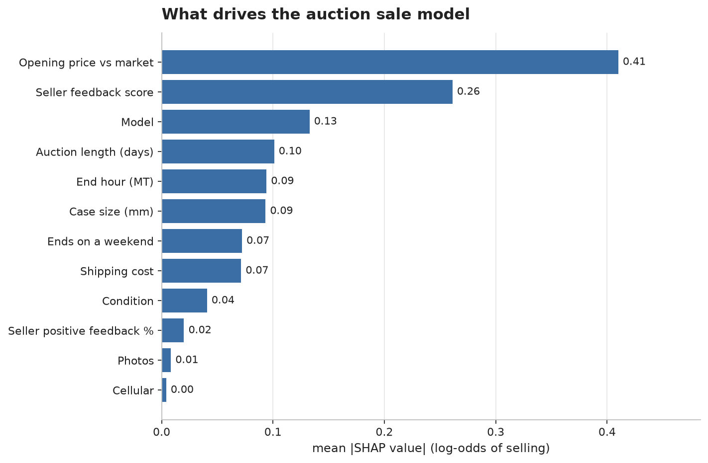</p>

**Opening price relative to the market** is the most important feature (mean |SHAP| 0.41 log-odds), ahead of seller feedback (0.26), model (0.13) and auction length (0.10). With every other feature at its observed value, the average predicted chance of selling falls from **48%** for an opening bid at a quarter of the market price to **36%** at the market price, **27%** at 1.5× and **21%** at 3×.

<p align="center">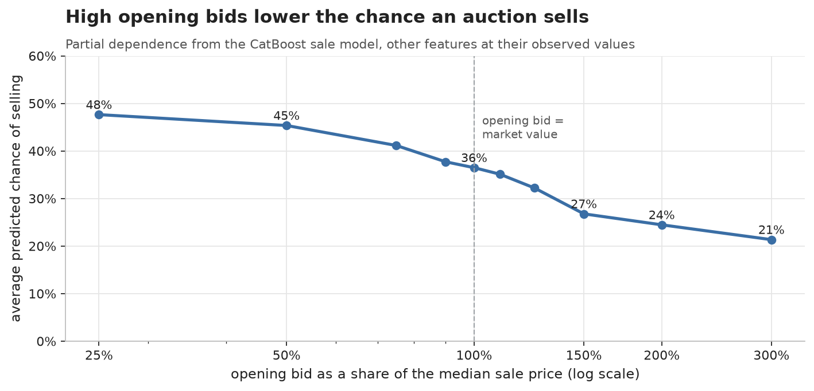</p>

### What will it sell for?

**Sample:** 1,873 sold single watches from 1,196 sellers, excluding gold and extreme sale prices.

**Accuracy:** the out-of-fold **R² is 0.90**, with a mean absolute error of $28.18 and a median absolute percentage error of 14.7%. A baseline that predicts the median sale for the same model and condition (computed inside each training fold) reaches R² = 0.87 and $28.99. So most of the price is model and condition; the remaining features improve the fit but not the typical error by much.

<p align="center">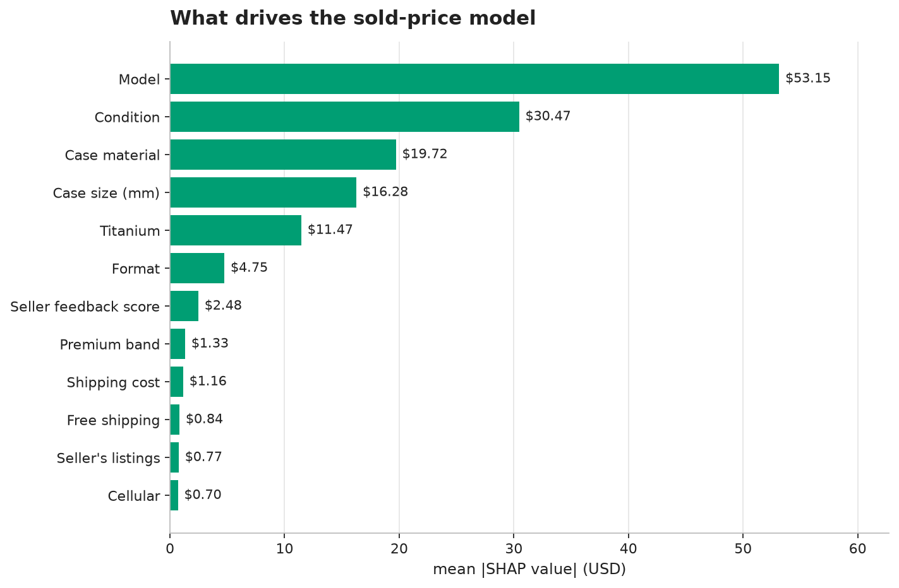</p>

By mean |SHAP|, the model ($53.15), condition ($30.47), case material ($19.72), case size ($16.28) and titanium ($11.47) dominate. Material and titanium overlap: every Ultra is titanium, so the two share credit for it. Format comes next ($4.75). Seller feedback ($2.48), shipping cost ($1.16) and free shipping ($0.84) barely move the price.

<p align="center">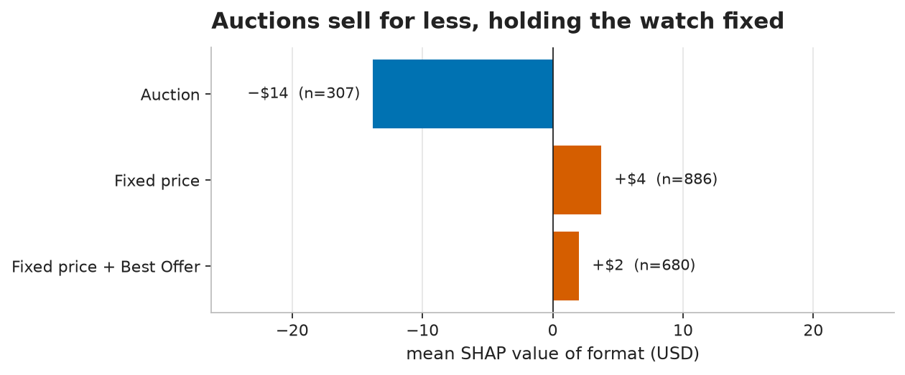</p>

**Format:** with everything else held fixed, an auction's format SHAP value averages **−$13.79** (n = 307), against +$3.72 for fixed price (n = 886) and +$2.02 for fixed price with Best Offer (n = 680). Fixed-price-with-Best-Offer sales are recorded at the list price, so their true effect is somewhat lower.

**Two sales, explained.** Each prediction starts from the average sale ($172.44) and adds one SHAP value per feature. A typical used Series 9 sold for $130 and is predicted at $130.46. Used condition (−$16.64), aluminum case (−$11.62) and the 41 mm size (−$9.71) pull it down.

<p align="center">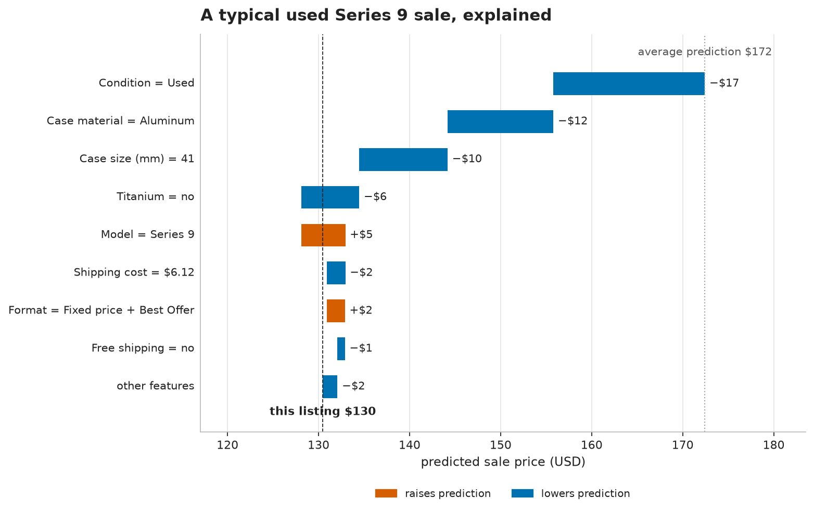</p>

A used Ultra 2 sold for $315 and is predicted at $311.46. Titanium shows up in material (+$48.72) and titanium (+$30.01), next to the model (+$45.17) and the 49 mm case (+$27.96).

<p align="center">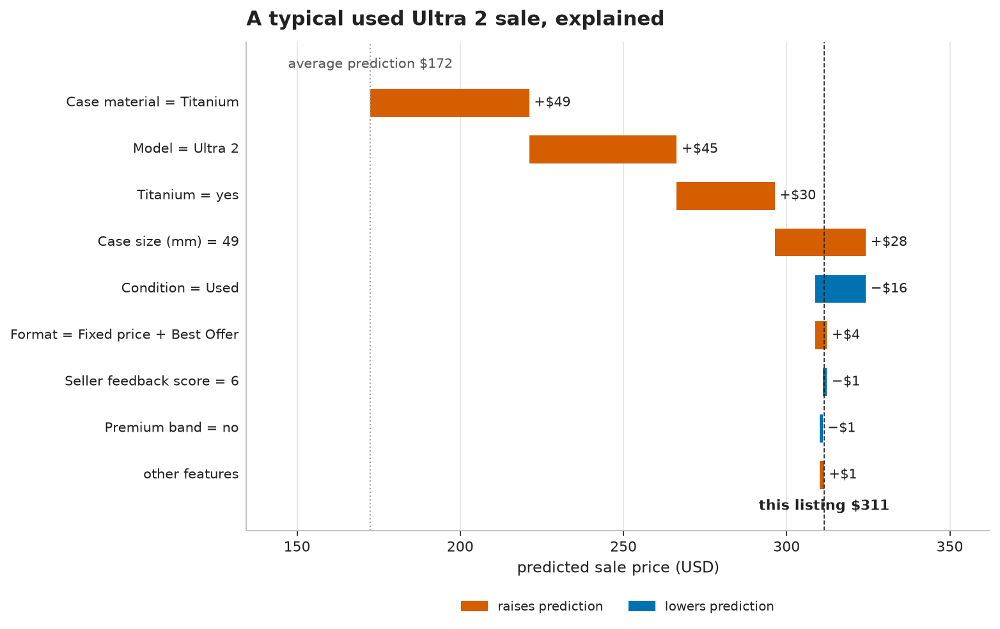</p>

## How the data was collected

The collector is a Python program (in `collector/`) that ran for one week. It used the eBay Browse API: the US marketplace, category 178893 (Smart Watches), brand Apple. Shipping costs were estimated for a buyer in ZIP 80202 (Denver). It stored every observation in SQLite.

<p align="center">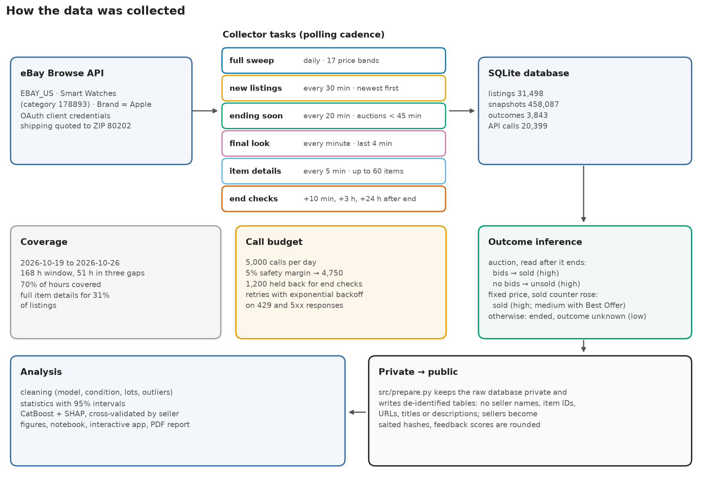</p>

**Cadence.** A scheduler runs every minute and decides which tasks are due:

| Task | Every | What it does |
|:--|:-:|:--|
| Full sweep | 24 h | pages through the whole category in 17 price bands, splitting any band with more than the API's 10,000-result window; 7 sweeps saw 24,992–26,637 items each |
| New listings | 30 min | the newest listings, so items are seen soon after they start |
| Ending soon | 20 min | auctions ending within 45 minutes, to record late bidding |
| Final look | 1 min | each auction in its last 4 minutes |
| End checks | 5 min | re-reads each listing 10 minutes, 3 hours and 24 hours after it ends |
| Details | 5 min | up to 60 full item records per tick (item specifics, lifetime sold count, seller details) |

**Outcomes.** The Browse API does not report sales directly, so outcomes are inferred, with a confidence level for each:

| Outcome | Rule | Confidence | Listings |
|:--|:--|:-:|--:|
| Sold | auction ended with bids, or fixed-price `sold_quantity` rose without Best Offer | high | 1,327 |
| Sold | fixed-price sale while Best Offer was on (price paid unknown) | medium | 734 |
| Sold | auction last seen with no bids whose sold counter rose (Buy It Now or offer) | medium | 2 |
| Unsold | auction ended with no bids | high | 385 |
| Reserve not met | auction ended with bids below the reserve | high | 9 |
| Ended, outcome unknown | ended or disappeared with no sale signal | low | 1,386 |

Unknown endings are never counted as sales, so sale rates are lower bounds.

**API budget.** eBay allows 5,000 calls per day. The collector kept a 5% safety margin, held 1,200 calls in reserve for end checks, and backed off exponentially on errors. Batch `getItems` calls returned 403, so it switched to single `getItem` calls. In total it made **20,399** calls (18,020 item reads, 2,375 searches): 20,205 succeeded and 130 returned 404 (listings already removed).

**Gaps.** The collector was offline three times, for 51.1 of the 168.2 hours (69.6% coverage). Charts over time shade them.

<p align="center">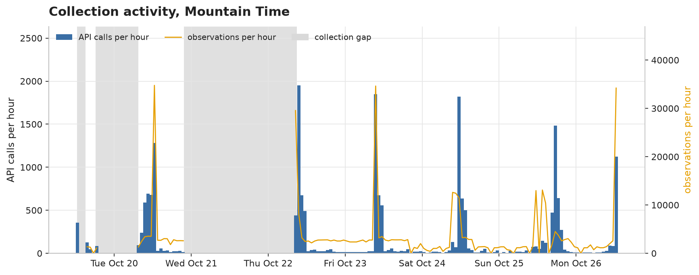</p>

| Gap (MT) | Hours |
|:--|--:|
| Mon Oct 19, 12:25 PM – 3:00 PM | 2.6 |
| Mon Oct 19, 6:10 PM – Tue Oct 20, 7:27 AM | 13.3 |
| Tue Oct 20, 9:41 PM – Thu Oct 22, 8:54 AM | 35.2 |

Most outcomes survive a gap, because end checks run up to 24 hours later and a sweep finds listings that disappeared. What a gap loses is the bidding inside it, and the exact end time of fixed-price listings that ended during it.

**Cleaning.** Titles and item specifics give the model, condition, case size, material, cellular, Hermès, titanium, premium bands and gold. Full details were fetched for 30.6% of listings; 59.3% have no brand field in the item specifics, so titles carry most of the information. The analysis set keeps 28,214 single watches. It drops:
- 632 multi-watch lots, 343 accessories and 116 other items
- 1,130 watches with no identifiable model
- 868 robust price outliers

Formats: 18,991 fixed price with Best Offer, 10,910 fixed price, 1,597 auctions.

**Privacy.** The published data (`data/public/`) and the app contain no seller usernames, item IDs, listing URLs, titles, descriptions, images or raw API responses. Sellers appear only as salted one-way keys, the salt is not stored, and feedback scores are rounded. API credentials and the raw database are not part of the repository.

## Limitations

1. **One week, with gaps.** Seven days is short for slow, long-running listings, the gold ones above all, and 30% of the window is missing. Weekly or seasonal patterns can't be studied.
2. **Best Offer prices are unknown.** 734 sales were made while Best Offer was on and are recorded at the list price, so their prices are upper bounds.
3. **Sale rates are lower bounds.** 1,386 listings ended with no confirmed outcome and are counted as not sold.
4. **Latest values only.** The database stores the latest value of each field, which leaks the outcome for some fields (Best Offer and Buy It Now on auctions, seller listing counts). These are excluded from the auction models, but a snapshot-at-listing design would be cleaner.
5. **Asking vs selling mixes discounting and selection.** Active asks are partly the listings that don't sell, so the ratios are not the discount a seller accepts on a given watch.
6. **Different sources.** Part I's prices came from other marketplaces and an earlier date; the comparison is between model-level summaries, not the same listings.
7. **Title-based features.** Regex extraction misses some attributes, and 1,130 watches had no identifiable model.
8. **The sale model is modest.** AUC 0.69 from 525 auctions, and its probabilities are too spread out (calibration slope 0.65).

## Future work

- Run the collector on an always-on server for several months, with no gaps, and track the gold listings over that time.
- Use eBay's Marketplace Insights API (it requires approval) for accepted Best Offer prices.
- Store a snapshot of each listing's buying options when it is first seen, so auction models can use Best Offer and Buy It Now without leakage.
- Fit hazard models with time-varying covariates such as price cuts and bid counts.
- Compare seller strategies: who reprices, by how much, and whether it helps.

## Project structure and reproduction

Everything from figures to the app runs from the de-identified tables in `data/public/`:

```bash
python -m venv .venv && source .venv/bin/activate
pip install -r requirements.txt
make figures    # regenerate images/ and docs/results.json from data/public/
make notebook   # generate and execute notebooks/01_from_asking_to_selling.ipynb
make app        # build the app data (app/data.js)
make pdf        # build the PDF report
make test       # unit tests (pip install -r requirements-dev.txt first)
make audit      # check every number in this README against docs/results.json
make serve      # http://localhost:8000
```

```
├── collector/      eBay Browse API collector: scheduler, API client with call budget, SQLite storage, outcome inference
├── data/public/    de-identified listings, auction bid paths, collection activity and gaps, Part I model summaries
├── src/            data preparation, loading, statistics, analysis, CatBoost + SHAP models, visualization
├── notebooks/      01_from_asking_to_selling.ipynb (analysis with outputs)
├── images/         figures generated by scripts/make_figures.py
├── app/            interactive site (published by GitHub Pages) and its data build script
├── scripts/        collector entry points; figure, notebook and PDF generation; headless-browser test of the app
├── tests/          unit tests
├── docs/           results.json (every reported number) and claims_audit.md
├── reports/        PDF report output (generated by make pdf)
└── Makefile, requirements.txt
```

### Collecting new data

The collector needs eBay developer credentials (an application's client ID and secret) in a `.env` file at the repository root. `.env.example` lists the variable names. Then:

```bash
python scripts/collector/run_collector.py --days 7      # collect for a week into data/raw/
python scripts/collector/run_collector.py --mock --simulate-hours 72   # offline run against a simulated market
PIG2_SELLER_SALT=$(openssl rand -hex 32) make data      # raw database -> data/public/
```

`make data` needs the raw database, which is not published. The seller key salt is read from the environment and never written down, so seller keys can't be reversed.

### PDF report

`make pdf` builds a print-ready version of this README, `reports/Plated_in_Gold_Part_II_Andre_Davis.pdf`, and copies it to `app/report.pdf`. It uses [pandoc](https://pandoc.org) if available and falls back to the Python `markdown` package, then prints with Google Chrome or Chromium. The browser is detected automatically on macOS and Linux, or can be set with the `CHROME` environment variable. The print layout is in `scripts/pdf_style.css`.

*License: MIT*
